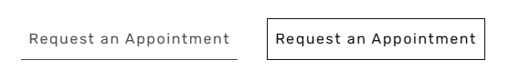

# 🦷 Letra de la Clínica Manson & Chi Dentistry

**Contexto:**
Usted ha sido asignado para realizar el mantenimiento y actualización del sitio web de la clínica "Manson & Chi Dentistry".
* 📥 **Recurso:** Se le entrega un [archivo .zip con el sitio aquí](https://drive.google.com/file/d/1DoN-xyUA79YUf1QFhSpN1OMsA7PPS08E/view?usp=sharing).
* **Instrucción:** Deberá importarlo a su entorno local (LocalWP) para trabajar.
* **Recomendación:** Explore el *customizer* con tranquilidad antes de comenzar a realizar cualquier cambio.

---

## A. Gestión de Contenidos y Estructura (15 pts)

### 1. Ajuste de Menú de Navegación (2 pts)
El equipo de UX detectó que el menú es demasiado extenso.
* **Tarea:** Eliminar todos los subservicios del menú principal desplegable.
* **Nota:** Los subservicios deben seguir existiendo como páginas, pero no deben figurar en el menú principal.

### 2. Análisis de Estructura (3 pts)
Navegue el panel de administración e identifique: ¿Cuáles son los *Custom Post Types* (CPT) que están registrados actualmente en este sitio (además de Entradas y Páginas)?

> **Respuesta:**
>
> _________________________________________________________________________

### 3. Limpieza del equipo (3 pts)
Las técnicas Erin y Nyah ya no forman parte del equipo.
* Elimínelas del sitio.
* Agregue la bibliografía de Lily desde el [sitio actual](https://mansonandchidentistry.com/about/#team-members).

### 4. Gestión de Categorías del Blog (5 pts)
El blog actual está desorganizado. Se solicita:
1.  Crear 3 categorías nuevas basadas en los posts actuales.
2.  Eliminar la categoría "Uncategorized".
3.  Establecer "Clinic News" como la categoría por defecto.
4.  Asignar los posts existentes al menos una categoría.

### 5. Redes Sociales (2 pts)
Marketing digital ha cerrado la cuenta de Twitter (X).
* **Tarea:** Elimine todo rastro de Twitter del sitio.

---

## B. Nuevo Contenido (10 pts)

### 6. Agregar un bloque de Testimonios en la HOME (5 pts)
Agregue reseñas de clientes en la sección titulada *“See what our patients have to say”*.
* Utilice contenido real extraído de las [reseñas de Google Maps de la clínica](https://www.google.com/search?q=mason+and+chi+dentristry&oq=mason+and+chi+dentristry&gs_lcrp=EgZjaHJvbWUyBggAEEUYOTIGCAEQLhhA0gEINDk0MmowajGoAgCwAgA&sourceid=chrome&ie=UTF-8#lrd=0x5490126f6d3b43f1:0xeda4dc1f8ea3c343,1,,,,).
* Copie al menos **2 reseñas recientes**.

### 7. Nuevo Servicio con IA (5 pts)
La clínica ofrecerá un servicio de sedación avanzada.
1.  Instale un plugin que le permita duplicar contenidos.
2.  Duplique el servicio existente "Dental Sedation".
3.  Nombre del nuevo servicio: **"Advanced Sedation"**.
4.  Utilizando una IA generativa, genere contenido persuasivo para este nuevo servicio.
5.  Publique el nuevo servicio.

---

## C. Diseño y CSS (15 pts)

### 8. Solución de Bug en "About Us" (5 pts)
Hay un error en la página `/about`. La información de la Dr. Connie Manson no se está mostrando, aunque está cargada en el backend.
* **Corrección:** Inspeccione el sitio, encuentre la regla CSS que está ocultando su información y elimínela/corríjala.
* **Layout:** El cliente exige que, en versión Desktop, la Dr. Connie Manson tenga la misma jerarquía que los otros doctores. Modifique el layout para que los doctores se muestren en **3 columnas de igual ancho** (cada uno ocupando 1/3 del espacio).

### 9. Subtítulo en /blog (4 pts)
Cambie el subtítulo de la página `/blog`.
* Actual: "Our Latest Office News"
* **Nuevo:** "Get the latest Dental News"

### 10. Estilo de Botón "Request Appointment" (2 pts)
El equipo de diseño notó que el ítem del menú "Request an Appointment" solo tiene un borde inferior.
* **Tarea:** Modifique el CSS para que este botón tenga borde en los 4 lados, pareciéndose a un botón sólido o recuadro completo.

### 11. Pie de Página (4 pts)
* **Footer:** Sustituya el texto "Nombre y Número de Estudiante" por sus datos reales.
* **Logo:** Agregue el Logo de la clínica en la primera columna del pie de página, justo después de la información de "Our Office".

### 12. Exportar (Final)
Utiliza la herramienta **Local by Flywheel** para exportar el sitio y guardarlo en `D:/PARCIALES/…`.